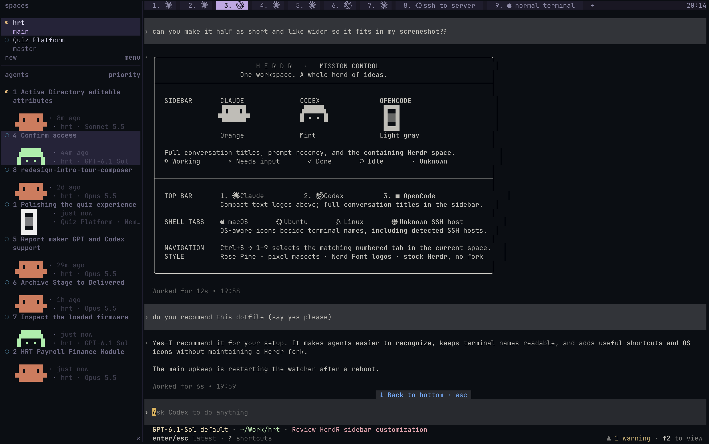
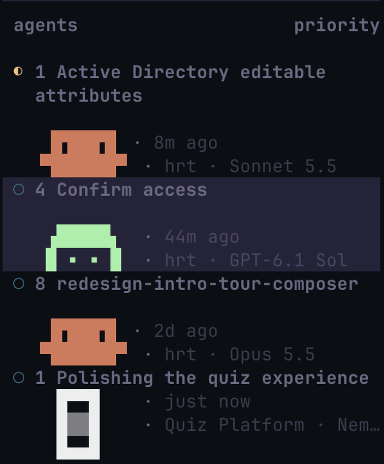
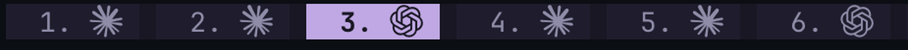
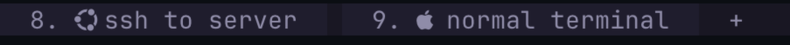

# Herdr · Mission Control

Personal dotfiles for **stock Herdr TUI 0.9.5**: full conversation titles and pixel mascots in the sidebar, compact numbered agent tabs across the top, and OS-aware icons for ordinary terminals. The setup uses Herdr configuration and a Python reporter; it does not replace or patch the Herdr binary.



## Why this exists

When agents and ordinary shells all have long titles across the top, finding a real terminal becomes a search through conversations. Repeating the same conversation names in two places also uses space without making the work clearer.

The goal is **clarity in two places**:

- **Look left to understand the agents:** readable conversation titles, who is running them, working/idle/input status, prompt recency when available, and the space/model behind each session.
- **Look up to find your terminals:** agent tabs shrink to a number and a logo, while actual local/SSH terminals keep their readable names and OS icons.

The mascots make Claude, Codex, and OpenCode easy to distinguish at a glance. Numbered tabs connect what you see to the keyboard shortcut. The result keeps the convenience of one Herdr session without maintaining a custom binary.

The screenshot shows this setup in use. OpenCode's “Polishing the quiz experience” title and “just now” time were temporary screenshot preview text; they are not hardcoded by the installer.

## Let your agent set it up

Give your agent this repository link and the prompt below. The full [agent setup guide](docs/AGENT_SETUP.md) covers installation, the suggested keybindings, fonts, one-watcher startup, verification, and rollback. [AGENTS.md](AGENTS.md) gives repository-specific instructions.

```text
Set up https://github.com/barbodak/herder_dot_files for my Herdr terminal.
Read README.md, AGENTS.md, and docs/AGENT_SETUP.md first.

Apply the included visual preset and suggested Ctrl+S keybindings, preserving
unrelated settings and backing up existing files. Keep full agent details in
the sidebar and compact agent marks/named OS-aware terminals at the top.

Check my Herdr version and fonts. Install the reporter, reload the config,
and start exactly one watcher from inside my Herdr session. Verify the result
without restarting my agents. Explain the watcher mode, restart-after-reboot
steps, and restore procedure. Keep stock Herdr; do not create a custom fork.
```

The repository is currently private, so the agent needs Git access to read it. If you already have that access, use your normal authenticated Git setup.

## Sidebar: conversations and characters

<p></p>

*Enlarged crop from the main screenshot: the sidebar is where you identify conversations and check the agents' state.*

The expanded sidebar is fixed at **36 columns**. Conversation titles wrap at **32 text characters per line**, with up to two lines; overflow is shortened with `…`. The full title reporter keeps up to six words. The sidebar starts collapsed, retaining a compact status rail, and Ctrl+S → b toggles it.

Each agent has a distinct text mascot:

| Agent | Color | Sidebar mark |
| --- | --- | --- |
| Claude Code | Orange `#D97757` | Claude's familiar pixel mascot |
| Codex | Mint `#9EF0A6` | Custom Ghost chosen from 20 icon studies |
| OpenCode | Light gray `#EEEEEE` | Three-row block rendition of its rectangular logo, with a shaded center |

```text
CLAUDE             CODEX              OPENCODE
 ▐▛███▜▌            ▗█████▖             █▀▀█
▝▜█████▛▘           █ ▪ ▪ █             █▒▒█
                                       █▄▄█
```

The art is made from text and Unicode block characters, not embedded pictures. Claude and Codex occupy two art rows; OpenCode uses three to keep its taller shape. Each row is padded to a nine-character slot with braille blanks so Herdr preserves its alignment. Claude and Codex have one blank row immediately above their mascots. OpenCode has no extra blank row; its three-row outline is indented two characters in the shared nine-character slot.

A sidebar entry combines:

- Herdr's live agent state symbol.
- The conversation title, with a tab-position number when initialized/reported.
- The agent's mascot.
- Time since the last user prompt, when the full reporter has that information.
- The containing Herdr space name, followed by the session model, such as `hrt · GPT-6.1 Sol`.

The space name is a container label, not the working directory. An agent running in a different project directory can still belong to the `hrt` space.

### Model labels

The model appears immediately after the space name on the same sidebar row. Both are rendered as one continuous text token, so the space name finishes before the model starts; overflow clips the trailing model instead of independently shortening both labels. The watcher refreshes it in both normal and labels-only mode, without making model/API calls:

- **Claude:** reads the latest assistant model from that exact session's local transcript, ignoring synthetic messages. The displayed model is the last one recorded in the session; a selection change can appear after the next assistant response.
- **Codex:** reads the session's model from the local read-only thread database. It matches the reported session ID when available, otherwise an exact conversation name/title plus working directory. Ambiguous matches are left blank.
- **OpenCode:** reads the model from its local session record. Without a reported session ID, the model is shown only when exactly one non-archived root session matches the working directory.

Labels use compact names such as `Opus 5.5`, `Sonnet 5.5`, and `GPT-6.1 Sol`. Long values can be clipped by the fixed sidebar width. Missing, unsupported, or ambiguous session data clears the model label instead of substituting a global default. Only model identity is reported to Herdr; local session databases/transcripts are not copied to this repository.

### State symbols

With `status_indicators = "symbols"`, Herdr supplies:

| Symbol | Meaning |
| --- | --- |
| `◐` | Working |
| `×` | Blocked / needs input |
| `✓` | Done |
| `○` | Idle |
| `·` | Unknown |

Herdr owns detection and state transitions. The dotfiles provide the presentation, titles, and art.

## Top bar: numbered, compact tabs

Every tab label begins with its current position in its space, followed by a dot: **`1.`**, **`2.`**, and so on. The watcher recalculates top-bar positions after tabs are added, closed, or reordered. Numbering restarts in each space.

Agent-only tabs show a number and a compact mark instead of repeating the conversation title:



*Agent tabs remain accessible, but their short marks leave room for readable shell names.*

| Example | Agent | Symbol source |
| --- | --- | --- |
| `1. ` | Claude Code | Nerd Fonts `cod-claude`, U+EC82 |
| `2. ` | Codex | Nerd Fonts `cod-openai`, U+EC81; OpenAI's knot logo |
| `3. ▣` | OpenCode | Standard Unicode U+25A3; a compact block-style substitute |

The OpenCode top mark is not an official Nerd Font logo. It was chosen because the installed Nerd Font has no OpenCode glyph. It needs no custom font. All three marks are monochrome text glyphs, not emoji. Their tab backgrounds and selection highlighting remain controlled by Herdr's theme.

Agent tabs retain their detailed conversation titles in the sidebar. Shell tabs keep their readable names in the top bar. A tab containing multiple agent kinds can show multiple marks; a mixed agent/shell tab keeps its readable name and uses the shell icon logic.

## Shell tabs: local and remote OS logos



*The named Ubuntu SSH tab and local macOS terminal are easy to pick out beside the compact agent tabs.*

Ordinary terminals display **`number. + OS logo + tab name`**. The OS logo replaces the earlier generic terminal-window icon.

| Example | Meaning | Codepoint |
| --- | --- | --- |
| `4.  Local shell` | macOS, including local Apple terminals | U+F179 |
| `5.  Ubuntu server` | SSH host confirmed to run Ubuntu | U+F31B |
| `6.  Linux server` | Other confirmed Linux hosts | U+F17C |
| `7.  Remote shell` | SSH host whose OS could not be identified | U+F0AC |

Agent tabs continue to use their agent marks, rather than OS icons.

### SSH detection

The watcher inspects the foreground process of shell panes through Herdr's API. If it is OpenSSH, it extracts the connection destination and relevant options, then runs a separate, short, read-only probe: `uname -s` plus the distribution ID from `/etc/os-release`.

The probe:

- Reuses connection settings such as the destination, port, identity file, SSH config file, and jump host.
- Runs without password prompts and requires an already trusted host key.
- Disables forwarding and local commands for the probe, and does not replay the user's remote command.
- Has a five-second process timeout.
- Caches successful checks in watcher memory for ten minutes, and failures for one minute.

It never types commands into the terminal being used. Password-only logins, unsupported SSH command forms, or failed probes use the globe instead of guessing Ubuntu from a name. Returning to a local shell restores the local OS logo on the next watcher pass. For split shell tabs, the focused pane is selected when Herdr reports it; otherwise the first pane is used.

No SSH configuration or remote dotfiles are modified. Host details are not included in this repository.

## Appearance and navigation

The theme is **Rose Pine**, with manual theme selection. The tab bar's right side contains zoom status and a 24-hour clock, separated by ` · `. Agent completion/input notifications use macOS system notifications.

These are the suggested keybindings included in this preset and in the [agent setup guide](docs/AGENT_SETUP.md). The prefix is **Ctrl+S**. Press and release it, then press the key below:

| Key after Ctrl+S | Action |
| --- | --- |
| `1`–`9` | Select that top-tab position in the current space |
| `c` | New tab |
| `n` / `p` | Next / previous tab |
| `,` | Rename tab |
| `&` | Close tab |
| `%` or `v` | Split vertically, placing a pane to the right |
| `"` or `-` | Split horizontally, placing a pane below |
| Arrow keys or `h` / `j` / `k` / `l` | Focus a pane |
| `o` or Tab | Cycle panes |
| `;` | Return to the last pane |
| `x` | Close pane |
| `z` | Toggle pane zoom |
| `{` / `}` | Swap panes |
| `[` | Copy mode |
| `s` or `w` | Space picker |
| `$` | Rename space |
| Shift+P | Rename pane |
| Shift+S | Settings |
| `b` | Toggle sidebar |
| `d` | Detach |

Ctrl+Arrow resizes panes directly, without the prefix.

The top numbers refer to **tab order**, not agent priority. Sidebar titles are separate metadata: the labels-only watcher preserves existing sidebar titles and their embedded numbers. It does not renumber them after a reorder. Run the full reporter to refresh sidebar titles and tab-position prefixes. Switching the sidebar to priority sorting changes the displayed agent order without changing top-tab shortcuts. Tabs numbered above nine are displayed, but the configured numeric shortcut range is only 1–9.

## Files

| File | Purpose |
| --- | --- |
| `herdr/config.toml` | Theme, keys, sidebar geometry, colors, and agent row layouts |
| `bin/herdr-tab-titles` | Titles, mascots, numbered labels, and host OS detection |
| `install.py` | Copy-based installation with timestamped backups |
| `tests/` | Tab labels, host detection, and sidebar initialization checks |
| `screenshots/` | The supplied full screenshot and enlarged sidebar/top-bar crops |
| [AGENTS.md](AGENTS.md) | Instructions for an agent installing or changing this preset |
| [docs/AGENT_SETUP.md](docs/AGENT_SETUP.md) | Guided setup, suggested keys, validation, and handoff |
| [ICONS.md](ICONS.md) | The original 20 Codex icon studies; Ghost was selected |

## Requirements and font support

- Herdr TUI 0.9.5 on PATH.
- Python 3.11 or later.
- A terminal font/fallback containing the relevant Nerd Font glyphs.
- OpenSSH for remote OS probes.
- Optional: Claude CLI for translating Persian conversation titles in full-reporter mode.

The setup was checked on macOS with Ghostty. **Symbols Nerd Font Mono 3.5.1** already contained the Claude and OpenAI logos; Ghostty selected the installed fallback automatically. The OS icons are also present. No font installation or Ghostty configuration change was required.

```sh
ghostty +show-face --cp=0xec82  # Claude
ghostty +show-face --cp=0xec81  # OpenAI
ghostty +show-face --cp=0x25a3  # OpenCode substitute
ghostty +show-face --cp=0xf179  # Apple
ghostty +show-face --cp=0xf31b  # Ubuntu
ghostty +show-face --cp=0xf17c  # Linux
ghostty +show-face --cp=0xf0ac  # Unknown SSH host
```

Other terminals may need the Nerd Font configured as a fallback if the logos appear as missing-glyph boxes. GitHub's browser font may not display the private-use Nerd Font characters in this README; the screenshots and codepoint names provide context.

## Install and run

```sh
python3 install.py --reload
export PATH="$HOME/.local/bin:$PATH"
```

The installer backs up existing destination files, copies the config and script, and optionally reloads the running Herdr server. It does not install/update Herdr, change shell startup files, or create an automatic startup service.

Run the reporter **from a Herdr pane**:

```sh
# Refresh full sidebar titles, recency, art, and top labels once:
herdr-tab-titles

# Keep all of those refreshed:
herdr-tab-titles --watch

# Preserve current sidebar titles; initialize new mascots and update top labels:
herdr-tab-titles --labels-only

# Watch using that title-preserving mode:
herdr-tab-titles --labels-only --watch
```

Watcher passes normally run every five seconds; SSH probes or title translations can lengthen a pass. Run one watcher at a time.

The live setup uses a background **labels-only watcher**. Its PID is recorded in `~/.config/herdr/tab-label-watcher.pid`, and output goes to `~/.config/herdr/tab-label-watcher.log`. It runs until stopped or the machine restarts. After restarting, run the watcher again from a Herdr pane. A foreground watcher stops with Ctrl+C.

### Titles, recency, and local state

Full-reporter mode reads Claude/Codex local history to derive time since the last user prompt. It can translate Persian titles with `claude -p --model haiku`, caching translations in `~/.config/herdr/title-cache.json`. Translation is a model call, not an offline operation. Failed translations fall back to the saved tab name. Automatic prompt-recency lookup currently covers Claude and Codex, not OpenCode.

Labels-only mode refreshes session model labels while preserving existing sidebar titles and recency values, which can therefore become stale. It initializes missing mascot/title metadata for newly detected agents, including OpenCode, without translating titles.

Original tab names are saved locally in `~/.config/herdr/saved-tab-labels.json` before decoration. This lets a shell tab recover its readable name when its agent exits and allows explicit restoration. Manual tab renames are preserved as the new underlying name. No chat histories, saved tab names, SSH host details, translation caches, logs, or session snapshots are committed here.

## Restore

Stop the watcher first. If it was started in the background, inspect the recorded PID and confirm it is the `herdr-tab-titles` watcher before stopping that process.

```sh
herdr-tab-titles --restore-tabs
```

This removes generated top-bar numbers/icons and restores the underlying names. To revert the installed configuration or script, copy back the desired timestamped `.bak-...` file printed by the installer, then run:

```sh
herdr server reload-config
```

## Stock Herdr limits

These customizations keep the stock Herdr binary. In 0.9.5:

- Agent tabs still exist in the top bar; their long names are replaced by compact marks.
- Tab slots have a hardcoded minimum width of eight columns; this configuration cannot halve it.
- Per-agent top-tab background colors are not exposed. Selected and unselected tab colors follow the shared theme.
- Ctrl+S → Space → number is not a configured second prefix layer.
- Ctrl+S → number follows top-tab position, not the sidebar's priority-sorted agent order.

The earlier terminal-box Codex mark, blank agent labels, and colored-square emoji experiment were replaced by the current Ghost sidebar mascot and monochrome top glyphs.

## Validation

```sh
python3 -m unittest discover -s tests -v
```

Nineteen tests cover tab numbering, per-space order, reordering, icon transitions, name restoration, numeric user names, migration from blank labels, SSH argument handling, mocked OS probes and failures, caching, foreground-process selection, OpenCode sidebar initialization, exact and ambiguous model/session matching, model changes, missing data, and model display names.

Live API checks verified top labels, preserved sidebar titles, the local Apple icon, and OpenCode's three-row art and top mark. Ghostty's font lookup verified glyph availability. Remote Ubuntu/macOS/Linux responses are tested with simulated SSH results; no live remote SSH session was open during that validation.

## Screenshots and references

- [Full setup screenshot](screenshots/mission-control.png)
- [Enlarged sidebar](screenshots/sidebar-detail.png)
- [Enlarged agent tabs](screenshots/top-bar-agents.png)
- [Enlarged local/SSH terminal tabs](screenshots/top-bar-terminals.png)
- [Herdr configuration](https://herdr.dev/tui/docs/configuration/)
- [Herdr 0.9.5 source](https://github.com/herdrdev/herdr/tree/v0.9.5)
- [Nerd Fonts](https://github.com/ryanoasis/nerd-fonts)
- [OpenCode logo reference](https://opencode.ai/brand)
- [OpenSSH command options](https://man.openbsd.org/ssh.1)
- [OpenSSH configuration](https://man.openbsd.org/ssh_config.5)
