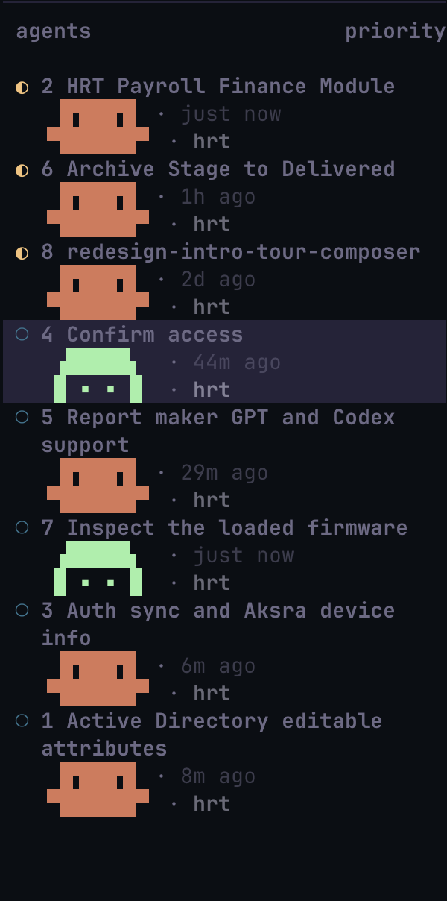

# Herdr dotfiles

Personal terminal UI configuration for **Herdr TUI 0.9.5**, with a Rose Pine theme, tmux-style Ctrl+S prefix, custom agent mascots, and English conversation titles.



## Included

- `herdr/config.toml`: theme, pane/window shortcuts, sidebar rows, and a fixed 36-column sidebar.
- `bin/herdr-tab-titles`: English title reporting, two-line wrapping at 32 text columns, tab-number labels, prompt recency, and agent mascots.
- `install.py`: installs both files with timestamped backups.
- `screenshots/`: before and after screenshots supplied during customization.
- [ICONS.md](ICONS.md): all 20 icon options from the design session.

Claude keeps its orange pixel mascot. Codex uses the mint Ghost, occupying the same 9-column × 2-row footprint:

```text
 ▗█████▖
 █ ▪ ▪ █
```

The script pads both rows to nine cells with braille blanks so Herdr preserves their alignment.

## Install

Requires Herdr 0.9.5 on PATH and Python 3.11+. The screenshots use macOS; these dotfiles do not install or update Herdr.

```sh
python3 install.py --reload
export PATH="$HOME/.local/bin:$PATH"
herdr-tab-titles
```

Run title reporting from inside a Herdr pane. To keep titles and recency fresh, leave the watcher running in a shell terminal:

```sh
herdr-tab-titles --watch
```

The reporter reads Claude/Codex local history to derive prompt times. Persian titles are translated with the locally installed `claude -p --model haiku` command and cached under `~/.config/herdr/title-cache.json`; that optional translation makes a model call. Failed translations fall back to the existing tab label. It renames single-agent tabs to their English conversation titles. No histories or caches are included in this repository.

## Existing shortcuts

Press Ctrl+S, release it, then press the key shown.

| Keys after Ctrl+S | Action |
| --- | --- |
| `1`–`9` | Select tab in tab order |
| `c` | New tab |
| `n` / `p` | Next / previous tab |
| `,` | Rename tab |
| `%` or `v` | Split right |
| `"` or `-` | Split down |
| `h` / `j` / `k` / `l` | Focus pane |
| `z` | Zoom pane |
| `b` | Toggle sidebar |
| `d` | Detach |

## Requested next layout

The target is to show agents only in the sidebar, shell terminals only in the top bar, number agents by their visible sidebar order, and use Ctrl+S → Space → number for shell terminals.

**This separation is not implemented in these stock-Herdr dotfiles.** Herdr 0.9.5 provides `keys.focus_agent` for visible agent order, but has no configuration option to hide agent tabs from the top bar or define a second prefix key layer. Those parts require a custom TUI build. The current script's numbers refer to tab order, not the sidebar's priority order.

References: [configuration](https://herdr.dev/tui/docs/configuration/), [configuration reference](https://herdr.dev/tui/docs/config-reference/), [Herdr source](https://github.com/herdrdev/herdr/tree/v0.9.5).

## Restore

The installer prints the location of every backup. Copy the desired `.bak-<timestamp>` file back over its original destination and run `herdr server reload-config`. No server restart is required for the configuration changes here.

## Screenshots

[Original terminal-box icon and narrow title wrapping](screenshots/sidebar-before.png) · [Ghost icon and wider title wrapping](screenshots/sidebar-ghost.png)
